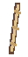

# Captain's Baton

Rare booster; stable ID `captain_s_baton`. Restricted to warrior.

## Purpose and operation

Adds 1 maximum stamina, refreshed each round. Each orthogonally touching weapon gains +2 damage. Each source applies once per target, regardless of shared edges; distinct sources stack.

Activates in the shared priority and backpack reading order, at most once per ordinary round before explicit repeat effects. All listed activation costs are checked together. No item-specific cooldown, random chance or once-per-fight cap is added. Unaffordable items skip without spending resources. Permanent stats apply only while equipped; combat state resets according to the shared combat rules. Companions are auto-activating equipment, not separately targetable units.

## Strengths and combinations

Passive support leaves activation resources for other equipment. Orthogonal adjacency support and available mana/stamina determine the best arrangement. Strategic combinations grant no unlisted bonus.

Touching bonuses are listed above; there are no other supplied bonuses.

## Acquisition and crafting

Eligible for the rare item reward pool subject to class restrictions. No bespoke shop price or drop probability is assigned. Craft: Duelist's Coin + Standard Spike → Captain's Baton. Outgoing recipes: Last Legion Aegis, War Council Seal. Each recipe consumes all listed quantities and produces one result when combat starts, requiring one unlocked orthogonally connected packed group. No catalyst or gold cost. Incomplete or disconnected groups consume nothing; an output with no fitting space enters the stash. Larger complete recipes take priority; outputs do not chain at the same combat start.

## Lore

Its last order was to bring everyone home.

## Visual design

An ivory tipped command baton with three brass bands. Use a clear connected silhouette, broad material shading and restrained highlights. No incidental colored rim lights. The footprint is `# / #` at 32 source pixels per cell; empty cells remain transparent. All rotations are allowed. Layered editable art and exports are linked below; visual acceptance remains unreviewed.

## State

Design candidate, not user-accepted art. Registered in the local runtime; design and art remain review candidates.

Editable [numeric layered source](icons/art/icon.sprite.json) and [Pixloom project](icons/art/icon.pixloom); exports remain review candidates pending user art acceptance.
